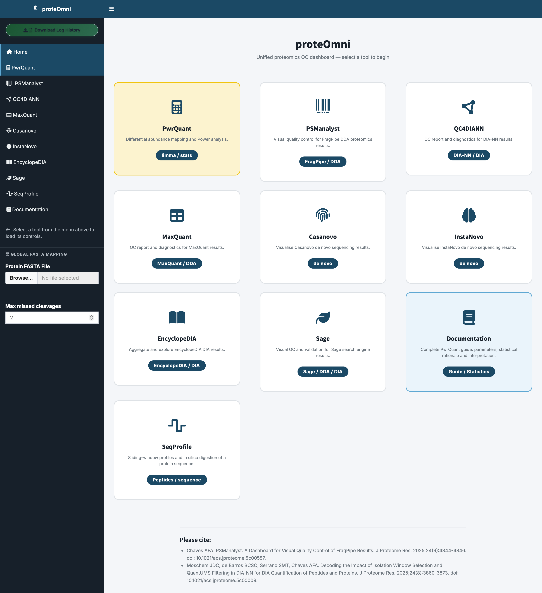
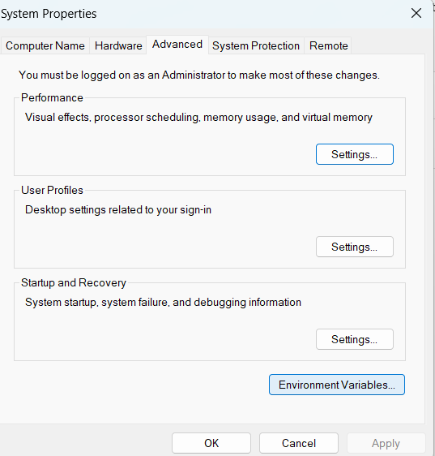
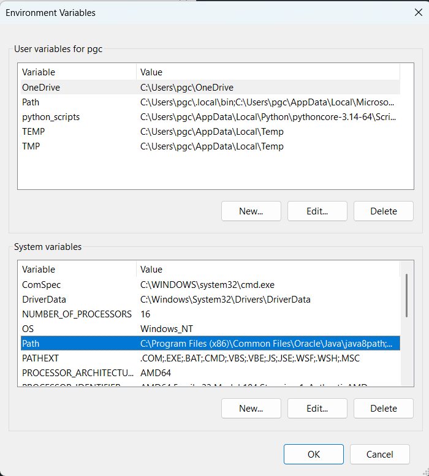
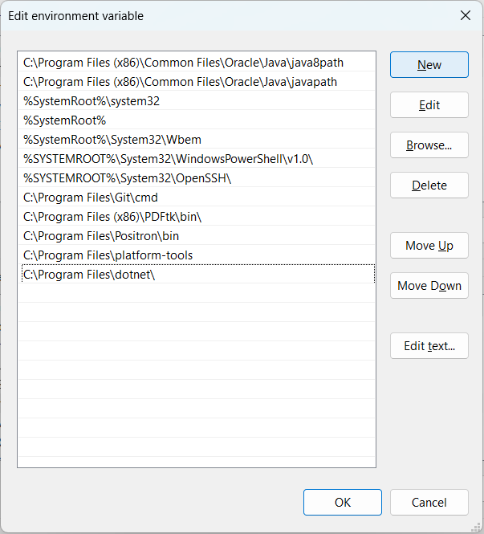
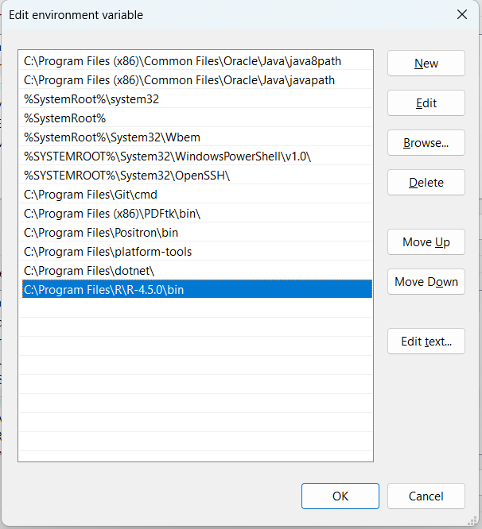

[](https://doi.org/10.5281/zenodo.21195113)


# proteOmni

**proteOmni** is a comprehensive, unified Shiny-based dashboard for visual quality control (QC), diagnostics, and differential abundance analysis of proteomics results from multiple search engines and acquisition strategies. It centralizes ten specialized modules covering DDA, DIA, and *de novo* sequencing workflows, single-sequence profiling and *in silico* digestion, and targeted proteomics assay design (SRM / MRM / PRM) into a single interactive application, with an in-app *Documentation* page describing the PwrQuant statistical workflow.

<p align="center">

</p>

---

## Table of Contents

1. [Benefits](#benefits-of-using-proteomni)
2. [System Requirements](#system-requirements)
3. [Installation & Launch](#installation--launch)
4. [Project Structure](#project-structure)
5. [Modules](#modules-included)
   - [PSManalyst](#1-psmanalyst--fragpipe--dda)
   - [QC4DIANN](#2-qc4diann--dia-nn--dia)
   - [PwrQuant](#3-pwrquant--limma--sam--stats)
   - [Casanovo](#4-casanovo--de-novo)
   - [InstaNovo](#5-instanovo--de-novo)
   - [EncyclopeDIA](#6-encyclopedia--encyclopedia--dia)
   - [Sage](#7-sage--sage--ddadia)
   - [MaxQuant](#8-maxquant--maxquant--dda)
   - [SeqProfile](#9-seqprofile--sequence-profiling)
   - [TargetDesign](#10-targetdesign--targeted-proteomics-srm--mrm--prm)
6. [Input File Reference](#input-file-reference)
7. [PwrQuant — Analytical Pipeline](#pwrquant--analytical-pipeline)
8. [Session Logging](#session-logging)
9. [Troubleshooting](#troubleshooting)
10. [Citation](#citation)

---

## Benefits of using proteOmni

- **Unified Interface** — One central hub for evaluating proteomics results across Data-Dependent Acquisition (DDA), Data-Independent Acquisition (DIA), and *de novo* sequencing — from FragPipe, DIA-NN, MaxQuant, Sage, EncyclopeDIA, Casanovo, and InstaNovo.
- **Deep QC Insights** — Generate detailed metrics including protease fingerprints, sequence logos, mass accuracy (ppm), retention time prediction errors, charge state and peptide length distributions, missed cleavages, GRAVY index, and isoelectric point (pI) profiles.
- **Interactive Visualization** — Explore 3D QuantUMS score distributions, interactive PCA plots, sample correlation matrices, cosine/Euclidean/Jaccard similarity heatmaps, and annotated MS/MS fragmentation spectra directly in the browser.
- **Peptide-to-Protein Mapping** — Map identified peptides onto user-provided FASTA sequences with a colour-coded protein sequence viewer.
- **Sequence Profiling & *In Silico* Digestion** — Paste any protein or peptide sequence to get sliding-window profiles (charge, hydropathy, hydrophilicity, amphiphilicity, surface accessibility, beta-turn propensity, B-cell antigenicity, MHC-I T-cell immunogenicity), or digest it with a preset or custom enzyme rule to see the theoretical peptides, the sequence coverage reachable in a given length and m/z window, and theoretical b/y spectra.
- **Targeted Proteomics Assay Design (SRM / MRM / PRM)** — Rank surrogate peptide candidates and product-ion transitions from a pasted or UniProt-fetched protein sequence following CPTAC / Hoofnagle et al. (2016) guidelines, verify proteome-wide proteotypicity against an uploaded FASTA (*in silico* digestion with optional isobaric Ile/Leu equivalence), and export Skyline-ready transition lists.
- **Differential Abundance Analysis** — Full limma-based workflow (or the permutation-based SAM of Tusher et al. 2001 as an alternative test) with normalization (limma between-array methods or edgeR TMM), batch correction (ComBat/SVA), flexible missing value imputation (KNN, MinProb, BPCA or missForest), MA plots, volcano plots, and a simulation-based prospective power analysis.
- **Prospective Power / Sensitivity Analysis** — Minimum detectable difference (MDD) estimated by simulating fresh datasets from the fitted empirical Bayes priors, spiking in known fold changes, and re-running the real design through `lmFit` → `eBayes` → BH — optionally including intensity-dependent missingness and imputation. A replicate sweep answers "how many replicates would I need?".
- **Functional Enrichment** — GO over-representation analysis (ORA) with `clusterProfiler::enrichGO`, run per contrast and split by regulation direction, using Bioconductor OrgDb annotation packages for 20 supported organisms, or GO annotations fetched from UniProt for any organism.
- **Protein-Protein Interaction Networks** — STRING interaction networks for the significant proteins of any contrast via the `STRINGdb` package, with nodes halo-coloured by up/down regulation and confidence-score edge filtering.
- **Publication-Ready Output** — Download filtered result matrices and universally formatted plots (PNG/ZIP) ready for reporting and publication.
- **Session Logging** — Automatic session and console logging with a one-click log download for full reproducibility.

<p align="center">

</p>

---

## System Requirements

| Requirement | Minimum | Recommended |
|---|---|---|
| **R** | 4.6.x (required by the pinned package set) | 4.6.x |
| **OS** | Windows 10, macOS, Linux | Latest stable release |
| **RAM** | 8 GB | 16 GB+ (for large DIA datasets) |
| **Browser** | Any modern browser | Chrome / Firefox / Safari |

> [!IMPORTANT]
> If you are using Windows, you will need to install [Rtools](https://cran.r-project.org/bin/windows/Rtools/). See troubleshooting for adding Rscript to your Environment Variables.

### R package dependencies

proteOmni auto-installs all required packages on first launch via the `bootstrap.R` script. No virtual environment or extra tooling is involved: packages go into your normal R library.

**Pinned versions.** Every package version (including indirect dependencies) is fixed in `proteOmni.lock`. Packages are downloaded from a dated [Posit Package Manager](https://packagemanager.posit.co) snapshot (CRAN + Bioconductor, as pre-built binaries on Windows and macOS). On each launch, `bootstrap.R` checks your library against the lock and reinstalls any package whose version differs. This can downgrade or upgrade packages you also use outside proteOmni. If you update such a package for other work, proteOmni will restore its pinned version the next time it starts. The snapshot date is recorded in `Session_Info_log.txt`.

**What happens when installation fails.** Packages that fail in the first pass are retried one at a time. If a required package is still missing afterwards, proteOmni stops before the app loads and lists each missing package with the reason reported by R; fix the cause and launch again (only the packages still missing are installed). proteOmni also stops if your R minor version differs from the one the lock was built for (currently R 4.6.x), because the pinned Bioconductor release has no pre-built packages for other R versions. Do not work around either stop with a plain `install.packages()`: that installs the current CRAN version, which the next launch replaces with the pinned one. See [Troubleshooting](#troubleshooting).

> **Maintainers:** to move to newer package versions, run `Rscript tools/update_lockfile.R <YYYY-MM-DD>` from the `app/` folder. Then run `source("bootstrap.R")` in a fresh R session, test the app, and commit the new `proteOmni.lock`. To add or remove a dependency, edit the lists at the top of `tools/update_lockfile.R`; never edit the lockfile by hand.

The direct dependencies are listed below; `proteOmni.lock` also pins everything they depend on.

**CRAN packages:** `shiny`, `shinydashboard`, `shinyjs`, `fresh`, `tidyverse`, `tidytext`, `janitor`, `ggpointdensity`, `ggtext`, `ggrepel`, `ggseqlogo`, `ggsci`, `plotly`, `viridis`, `RColorBrewer`, `ggfortify`, `seqinr`, `zip`, `DT`, `colourpicker`, `R6`, `gridExtra`, `scales`, `lavaan`, `naniar`, `patchwork`, `missForest`, `data.table`, `GGally`, `arrow`, `Peptides`, `httr`, `jsonlite`, `BiocManager`

**Bioconductor packages:** `limma`, `edgeR`, `Biostrings`, `sva`, `impute`, `pcaMethods`, `ComplexHeatmap`, `clusterProfiler`, `enrichplot`, `AnnotationDbi`, `STRINGdb`, `mixOmics`, `org.Hs.eg.db`

> The power analysis is implemented directly against limma's empirical Bayes objects and the non-central *t* distribution in base R, so the `pwr` package is **not** a dependency anymore. See [Step 7](#step-7--power-analysis--minimum-detectable-difference-mdd) for why a textbook power calculation does not apply here.

**OrgDb annotation packages (auto-installed on demand):** the organism selected in the PwrQuant *GO Enrichment* dropdown determines which Bioconductor `org.*` package is required (e.g. `org.Hs.eg.db` for human, `org.Mm.eg.db` for mouse). proteOmni installs the matching package (at the version pinned in `proteOmni.lock`) the first time that organism is used. 20 organisms are supported — see [Step 9](#step-9--functional-enrichment-ora-with-clusterprofiler).

---

## Installation & Launch

### Option 1 — Launcher scripts (recommended)

**macOS / Linux**

```bash
# Make executable (first time only)
chmod +x proteOmni_MacOS.command

# Double-click the file, or run from terminal:
./proteOmni_MacOS.command
```

**Windows**

Double-click `proteOmni_Windows.bat`. R must be on your system `PATH` (see [Troubleshooting](#troubleshooting) if you get a `Rscript not recognized` error).

### Option 2 — From R / RStudio / Positron

```r
setwd("/path/to/proteOmni/app")
source("run.R")
```

### Option 3 — From the terminal

```bash
cd /path/to/proteOmni/app
Rscript run.R
```

> **First launch note:** On the first run, `run.R` sources `bootstrap.R`, which installs every package at its pinned version (including Shiny itself) before the app starts. This may take several minutes. Subsequent launches are fast.

> Always start proteOmni through `run.R`. Calling `shiny::runApp("proteOmni.R")` directly fails on a fresh R installation, because R has to load the `shiny` package before it ever reads the app file. If you only want to install dependencies without launching the app, run `Rscript -e 'source("bootstrap.R")'`.

> [!TIP]
> Once you have all dependecies installed, you can copy the proteOmni_Windows.bat file (if Windows) or the proteOmni_MacOS.command (if MacOS) file and paste to your desktop as a shortcut and never touch the main folder again.

---

## Project Structure

```
proteOmni/
├── run.R                        # Launch script (sources bootstrap.R, then starts the app)
├── bootstrap.R                  # Installs packages at the versions pinned in proteOmni.lock
├── proteOmni.lock               # Pinned package versions (generated, do not edit)
├── tools/
│   └── update_lockfile.R        # Maintainers: regenerate proteOmni.lock
├── proteOmni.r                  # Main app file (UI + server, sources all modules)
├── proteOmni_MacOS.command      # One-click launcher for macOS / Linux
├── proteOmni_Windows.bat        # One-click launcher for Windows
├── modules/
│   ├── mod_PSManalyst.r         # PSManalyst module (FragPipe / DDA)
│   ├── mod_QC4DIANN.r           # QC4DIANN module (DIA-NN / DIA)
│   ├── mod_PwrQuant.r           # PwrQuant module (limma / SAM differential abundance)
│   ├── mod_PwrQuantDocs.r       # In-app Documentation page for PwrQuant
│   ├── dash_deNovo.r            # Casanovo de novo module
│   ├── mod_InstaNovo.r          # InstaNovo de novo module
│   ├── mod_EncyclopeDIA.r       # EncyclopeDIA module
│   ├── mod_Sage.r               # Sage module
│   ├── mod_MaxQuantMSMS.r       # MaxQuant module
│   ├── mod_SeqProfile.r         # SeqProfile module (sequence profiles + in silico digestion)
│   ├── mod_TargetDesign.r       # TargetDesign module (SRM / MRM / PRM peptide & transition design)
│   ├── utils_fasta.r            # Shared FASTA parsing / digestion + reusable FASTA sidebar submodule
│   │                            #   + SeqProfile & TargetDesign backends (profiling algorithms,
│   │                            #   digestion, proteotypicity, SRM/MRM/PRM scoring & transitions)
│   └── mod_TEMPLATE.r           # Template for adding new modules
├── tests/
│   ├── README.md                # How to run the tests and what they cover
│   ├── PwrQuant/                # testthat unit tests for the PwrQuant module
│   │   ├── run_tests.R          # Test runner (Rscript tests/PwrQuant/run_tests.R)
│   │   ├── helper-pwrquant.R    # Loads the module and builds shared fixtures
│   │   └── test-*.R             # cv, id-helpers, imputation, ingestion, limma-pipeline,
│   │                            #   missingness, plot-helpers, power-helpers, server,
│   │                            #   simulation, tmm
│   ├── utils_fasta/             # testthat unit tests for utils_fasta.r, including SeqProfile
│   │                            #   and TargetDesign (test-seqprofile.R, test-seqdigest.R,
│   │                            #   test-targetdesign.R)
│   ├── Sage/                    # testthat unit tests for the Sage iBAQ calculation
│   ├── imputation_strategies_sim.R  # Simulation behind the imputation FDR / power table
│   ├── test_mdd.R               # Smoke test of the MDD machinery on a real matrix
│   └── pwr_diag.R               # Temporary diagnostic of the Shiny reactive graph
├── training/                    # Example data for trying out the modules
│   ├── mtx_maxLFQ.tsv           # Protein abundance matrix (PwrQuant; also used by the tests)
│   └── fragpipe/                # FragPipe output (PSManalyst)
│       ├── combined_protein.tsv
│       └── yeast{1,2,3}/psm.tsv
├── www/
│   └── favicon.svg              # App favicon
├── images/                      # Screenshots and GIFs for README
├── LICENSE
└── README.md
```

Each module follows the standard Shiny module pattern with three exported functions:
- `<Module>_sidebar_ui(id)` — sidebar controls (rendered dynamically for the active module)
- `<Module>_body_ui(id)` — main panel tabs and plots
- `<Module>_server(id, ...)` — reactive server logic

The sidebar menu lists the modules in this order: **Home**, **PwrQuant**, **PSManalyst**, **QC4DIANN**, **MaxQuant**, **Casanovo**, **InstaNovo**, **EncyclopeDIA**, **Sage**, **SeqProfile**, **TargetDesign**, **Documentation**. Each module renders only its own sidebar controls when selected (including optional FASTA upload controls for modules that support FASTA mapping or iBAQ).

---

## Modules Included

### 1. PSManalyst — *FragPipe / DDA*

Visual QC for FragPipe DDA results. Point the module at the folder containing the `psm.tsv` files (one per experiment) and upload `combined_protein.tsv`; optionally upload a FASTA file for peptide-to-protein mapping. Sidebar filters include sample selection, Hyperscore and PeptideProphet probability sliders, protease specificity, and a plot colour picker. A protein abundance matrix (choice of metric and protein identifier) can be exported from the sidebar, as can a ZIP of all plots.

**Tabs:**

| Tab | Content |
|---|---|
| **PSM Viewer** | Single-plot builder with 21 graphics: protease fingerprint, N/C-termini sequence logos, m/z over RT, mass error (ppm), peptide length, GRAVY, pI, charge state, missed cleavages, uniqueness, Hyperscore, Next Score, PeptideProphet probability, Expectation, assigned modifications, top-20 proteins, N:C-terminus matrix, cysteine counts, AA frequency vs FASTA, and peptide yield vs. FDR |
| **MS/MS Spectrum Viewer** | Annotated b/y fragment ion spectrum for any selected PSM with colour-coded ion series (PDF download), plus a tidy fragment-ion table |
| **Protein Viewer** | Protein-level plots from `combined_protein.tsv` (coverage, organisms, protein existence, protein/top-peptide probability, total peptides, razor spectral count and intensity, MaxLFQ distribution, top-20 by MaxLFQ or spectral count) and a colour-coded **Sequence Coverage View** mapping peptides onto FASTA sequences |
| **Modification Diagnostic** | RT-shift profile of modified vs. unmodified peptide pairs (adjustable RT tolerance) with a paired-peptide table |
| **Similarity & Distance** | Pairwise sample scatterplot matrix (`GGally::ggpairs`), cosine similarity, Euclidean distance, and Jaccard similarity heatmaps |
| **iBAQ** | Intensity-based absolute quantification (summed peptide intensity / number of theoretical tryptic peptides) from the `peptide.tsv` found next to each `psm.tsv`. Controls box on top: peptide length window, missed cleavages and enzyme rule (defaults read from `fragger.params` in the loaded folder, editable), unique-peptides-only, exclude contaminants, log₂ export. Per-sample distribution, ranked abundance, most abundant proteins (relative iBAQ), and a protein × sample table with TSV download. Uses the sidebar FASTA when uploaded, otherwise the `protein.fas` files in the FragPipe folder |

---

### 2. QC4DIANN — *DIA-NN / DIA*

**Observation:** From version 2.6.0 DIA-NN have a nice `Analyze` module to help you process your data.

Diagnostics for DIA-NN `report.parquet` files. Optionally accepts a FASTA file (module sidebar) for peptide mapping and protease-specificity analysis. Sidebar controls include the protein identifier header (`Protein.Ids` / `Protein.Names` / `Genes`), `PG.MaxLFQ.Quality` and `Empirical.Quality` sliders, number of EFA factors, and a protein-matrix download.

**Tabs:**

| Tab | Content |
|---|---|
| **QC Filters & Distributions** | Single-plot builder with 15 graphics: XIC reconstruction, ion density (m/z vs RT), RT prediction error, charge state, peptide length, peptides and proteins per sample, cysteine counts, sparsity profile, missing values vs. median abundance, abundance before/after MAD normalization, missed cleavage sites, MS1 profile correlation, QuantUMS score distributions (interactive 3D Plotly), gene quantity distribution |
| **Interactive Viewer** | Sample correlation heatmap (Plotly), cosine/Euclidean/Jaccard similarity matrices, PCA, full pairwise sample correlation matrix (`ggpairs`), and exploratory factor analysis (EFA); all plots downloadable as a ZIP |
| **Peptide Mapping** | Colour-coded protein sequence coverage view (per protein and sample), amino acid frequencies, proteotypic vs. shared peptide counts and proportions, and a peptide mapping summary table — requires a FASTA file |
| **Protease Specificity** | Schechter–Berger P4–P4' sequence logos, for all runs combined and per run — requires a FASTA file |
| **Modification Diagnostic** | RT-shift profile of modified vs. unmodified peptides (adjustable RT tolerance and number of peptides shown) with a diagnostic table |
| **iBAQ** | Intensity-based absolute quantification (summed precursor intensity / number of theoretical tryptic peptides) from the same report and FASTA. Controls box on top: precursor intensity column, peptide length window, missed cleavages, proteotypic-only, log₂ export. Per-sample distribution, ranked abundance, most abundant proteins (relative iBAQ), and a protein × sample table with TSV download — requires a FASTA file |

---

### 3. PwrQuant — *limma / SAM / stats*

End-to-end differential abundance and statistical power analysis pipeline. Accepts any protein abundance matrix in `.tsv`, `.txt`, or `.csv` format (proteins × samples), with a checkbox to declare the values as already log2-transformed. See [PwrQuant — Analytical Pipeline](#pwrquant--analytical-pipeline) for full details, and the in-app **Documentation** menu item for a step-by-step explanation of the statistics.

**Tabs:**

| Tab | Content |
|---|---|
| **Metadata Mapping** | Editable table for assigning samples to conditions and batches; samples can be excluded from the analysis |
| **Sparsity** | Missing-value heatmap (`naniar::vis_miss`) |
| **Pre-processing QC** | CV distributions per condition, mean–variance relationship (loess trend), raw and normalized abundance boxplots, PCA and PLS-DA on raw and processed data |
| **Differential Abundance** | MA/Bland-Altman plots, volcano plots with user-selected protein labels, top-20 DAP bar mirror chart, raw p-value histograms per contrast. After a SAM run: the SAM plot (observed vs expected relative difference with the Δ band) and a per-contrast summary |
| **Correlation** | Inter-contrast logFC scatter with Spearman ρ and concordant/inverse/mismatch classification, with a downloadable table |
| **Power Statistics** | limma runs: prospective MDD power curve from simulated data (with summary table), an MDD-vs-replicates design sweep, and a conditional per-protein sensitivity map (diagnostic only). SAM runs: *d(i)* vs *s(i)* scatter and the Δ table (called, falsely called, FDR per Δ) |
| **Enrichment** | GO over-representation analysis with `clusterProfiler::enrichGO`, run per contrast and split by up/down direction; results shown as a dotplot (top terms per contrast) and a Manhattan plot (all enriched terms), across 20 supported OrgDb organisms or, with the UniProt annotation source, any organism in UniProt |
| **Interaction Network** | STRING protein-protein interaction network (`STRINGdb`) for a selected contrast, with nodes halo-coloured by regulation and edges filtered by a confidence score; unmapped proteins are listed for transparency |
| **Selected Proteins** | Abundance profiles for a user-selected set of proteins across conditions (adjustable grid columns) |
| **UpSet — Proteins by Condition** | Intersections of detected proteins across conditions, with a downloadable membership table |
| **Statistics Results Table** | Full per-protein results (limma `topTable` output, or the SAM table) filterable by significance status, downloadable as `.tsv` |
| **Z-Score Heatmap** | Row-scaled heatmap of significant or top-N proteins (`ComplexHeatmap`) with row clustering, downloadable cluster assignments, per-cluster abundance profiles, and per-cluster GO enrichment |

Sidebar downloads: statistics results (limma or SAM), ORA results, STRING network, and a ZIP of all plots.

The **Statistics** selector in the sidebar switches between **limma** (default) and **SAM** (Significance Analysis of Microarrays, Tusher et al. 2001); the controls specific to the selected method appear below it. See [Step 6b](#step-6b--sam-alternative-to-limma).

---

### 4. Casanovo — *de novo*

**Observation:** Starting from July 2026, Casanovo have a dedicated GUI built in Java language. Please, use the [CasanovoGUI app](https://github.com/Noble-Lab/CasanovoGUI).

Visualiser for [Casanovo](https://github.com/Noble-Lab/casanovo) *de novo* sequencing output. Loads all `.mztab` files from a user-specified directory. Sidebar filters: Casanovo score, mean per-amino-acid score, RT tolerance for the modification diagnostic, plot colour, and N/C-terminus logo widths.

**Tabs:**

| Tab | Content |
|---|---|
| **Interactive Plot Viewer** | Run metadata and ingest summary, plus a single-plot builder with 19 graphics: score and mean AA-score distributions, peptide length, charge state, m/z error, score vs. mean AA score, retained PSMs vs. score threshold (elbow), RT vs. m/z error, RT vs. PSM count, modifications summary, modified vs. unmodified PSMs, GRAVY, pI, median score by peptide length, m/z error vs. score, amino acid frequencies, N/C-terminus sequence logos, N:C-terminus co-occurrence probability |
| **PSM Table** | Filtered PSM table |

---

### 5. InstaNovo — *de novo*

Visualiser for [InstaNovo](https://github.com/instadeepai/InstaNovo) *de novo* sequencing results. Loads all `.csv` result files from a user-specified directory; optionally maps predicted peptides to a protein FASTA uploaded in the module sidebar. Sidebar filters: score (`log_probs`), RT tolerance, plot colour, N/C-terminus logo widths, and optional FASTA mapping.

**Tabs:**

| Tab | Content |
|---|---|
| **Interactive Plot Viewer** | Single-plot builder with 12 graphics: score distribution, peptide length, charge state, mass error (ppm), retained PSMs vs. score threshold, median score by peptide length, ppm error vs. score, GRAVY index, pI distribution, amino acid frequencies, N/C-terminus sequence logos |
| **PSM Table** | Filtered PSM table |
| **Modification Diagnostic** | RT-shift profile of modified vs. unmodified peptides with a diagnostic table |

---

### 6. EncyclopeDIA — *EncyclopeDIA / DIA*

Aggregates and explores EncyclopeDIA DIA results. Automatically discovers `*.encyclopedia2.txt`, `*.encyclopedia.txt`, and `*.mzML.features.txt` (`*.features.txt`) files from a user-specified directory (joining feature-level metrics onto Percolator PSMs in `Auto` mode, or loading PSM or feature tables independently); optionally maps peptides to a protein FASTA uploaded in the module sidebar. Sidebar controls: input table mode, q-value filter, and optional FASTA mapping. Plot selection, colours, faceting (`Facet by file` & `Facet columns`), font size, and ggplot2 theme controls live in the **Plot Controls** box at the top of the plot tab.

**Tabs:**

| Tab | Content |
|---|---|
| **Interactive Plot Viewer** | Single-plot builder with 17 graphics across Identifications & FDR (identifications per file, score, PEP, q-value, peptide yield vs. FDR), Peptide Properties (charge state, modifications, peptide length, GRAVY index, virtual 2D gel pI vs. MW, amino acid frequencies), and Feature Metrics from `*.features.txt` (precursor *m/z* vs. RT, ΔRT, MS1 & MS2 mass error, missed cleavages, feature scores, isotope dot product) |
| **Data Table** | Aggregated and filtered results table |

---

### 7. Sage — *Sage / DDA*

QC dashboard for [Sage](https://github.com/lazear/sage) search engine results. Accepts `results.sage.tsv` or `results.sage.parquet`. Sidebar filters: LDA discriminant score, q-value, RT tolerance, decoy removal, and separate target/decoy colours.

**Tabs:**

| Tab | Content |
|---|---|
| **Interactive Plot Viewer** | Single-plot builder with 15 graphics: number of PSMs, proteins & peptides by file, Sage discriminant score (LDA), charge state density, peptide length density, missed cleavages, GRAVY index, pI distribution, RT vs. mass error (Da), fragment error (ppm), RT vs. precursor error (ppm), precursor mass error density, peptide vs. protein q-value, peptide vs. spectrum q-value, peptide yield vs. FDR |
| **Modification Diagnostic** | RT-shift profile of modified vs. unmodified peptides (per sample, adjustable top-N) with a diagnostic table |
| **iBAQ** | Intensity-based absolute quantification (summed intensity of peptides unique to a protein / number of theoretical peptides) from `lfq.parquet`. Controls box on top: protein FASTA upload, peptide length window, missed cleavages and enzyme rule (defaults read from `results.json` next to the results, editable), exclude contaminants, log₂ export. Per-sample distribution, ranked abundance, most abundant proteins (relative iBAQ), and a protein × sample table with TSV download — requires the search FASTA |

---

### 8. MaxQuant — *MaxQuant / DDA*

QC module for MaxQuant results. Requires the path to the MaxQuant `combined` output directory; the module locates `msmsScans.txt`, `evidence.txt`, `peptides.txt`, `summary.txt`, and `proteinGroups.txt` in the `txt/` subfolder. To understand the files and meaning of each column variable from MaxQuant outputs, see [here](https://cox-labs.github.io/coxdocs/output_tables.html).

Each QC tab (Evidence, Peptides, MS/MS Scans) has its own plot selector, plot button, and plot (PDF) and data (TSV) downloads at the top of the box. The sidebar offers a protein abundance matrix export from `proteinGroups.txt` (Intensity / LFQ intensity / iBAQ, optional zero→NA and log2).

**Tabs:**

| Tab | Content |
|---|---|
| **Run Summary** | Processing status log, MaxQuant run summary (`summary.txt`), and a preview of the protein abundance matrix |
| **Evidence QC** | 14 plots from `evidence.txt`: m/z vs RT, data points distribution and vs m/z, peptide length, modifications, missed cleavages, identification type, charge state, m/z and mass distributions, mass error (ppm and Da), PEP distribution, taxonomy names |
| **Peptides QC** | Plots from `peptides.txt`: MS/MS spectra per peptide, peptides per experiment, experiment overlap (counts and UpSet), and more |
| **MS/MS Scans QC** | Plots from `msmsScans.txt`: identification rate per raw file and over RT, MS/MS scans over RT, precursor m/z vs RT, total ion current, ion injection time, base peak and precursor intensity, precursor apex fraction, precursor charge, identification rate by scan event (TopN), filtered peaks per spectrum, Andromeda score; plus a preview of the scans table |
| **Evidence Data** | Filtered `evidence.txt` table |
| **Peptides Summary** | Peptide-level summary table |
| **Modification Diagnostic** | RT-shift profile of modified vs. unmodified peptides (adjustable RT tolerance) with a diagnostic table |

---

### 9. SeqProfile — *sequence profiling*

Tools for a single protein or peptide sequence; no input file is needed. Paste a raw or FASTA-formatted sequence (or load the built-in example) in the **Sequence** box at the top, or type a UniProtKB accession (e.g. `Q07730`) and click **Fetch from UniProt** to load the canonical FASTA entry, header with protein name included, from `rest.uniprot.org/uniprotkb/{accession}.fasta` (needs internet access). The box shows the sequence length and warns about non-canonical or unsupported characters as you type. If several FASTA entries are pasted, only the first is used. The sequence is shared by two tabs: **Prediction Algorithms** (sliding-window profiles) and **In Silico Digestion** (theoretical peptides, sequence coverage and b/y spectra). Nothing is computed until **Predict** or **Digest** is clicked. All controls are in the main panel, so the module has no sidebar controls.

#### Prediction Algorithms tab

Choose one to three algorithms, adjust their parameters (one row per algorithm) and click **Predict**. The selector groups the thirteen algorithms into *Physicochemical*, *Structural / Membrane* and *Immunogenicity / Epitopes*.

A single scale can mislead (hydrophobic cores score high in Kolaskar-Tongaonkar, for instance), so several algorithms are drawn as **stacked tracks on a shared x axis**: zooming or panning one track moves the others, which lets peaks be compared position by position. With two or three algorithms the summary table also offers **Consensus regions**: stretches of window-centre positions where every selected algorithm crosses its own threshold at once (each algorithm needs a threshold; positions an algorithm does not score never count). A **minimum consensus length** next to the table drops shorter stretches, and the remaining consensus regions are shaded in orange across every track, over the blue bands of each algorithm's own regions.

When the **Eisenberg hydrophobic moment** is run at 100° with a threshold, clicking a region in the *Predicted regions* table draws a **helical wheel** (Schiffer-Edmundson projection) of the residues behind that region: the region's window centres plus the flanks of its first and last window, or 18 residues around the peak when that stretch exceeds 36 residues. Residues are coloured by Eisenberg hydrophobicity (read from `Peptides`) and the arrow is the hydrophobic moment of the drawn residues, pointing at the hydrophobic face.

The charge, Kyte-Doolittle, Hopp-Woods and Eisenberg profiles and the whole-sequence descriptors are computed by the [`Peptides`](https://cran.r-project.org/package=Peptides) package. TopPred and FoldIndex are built on `Peptides` values too (the Engelman-Steitz-Goldman scale for the former; Kyte-Doolittle hydropathy and Lehninger charge for the latter), with the window weighting and the formula in `modules/utils_fasta.r`. The remaining profiles use amino-acid scales stored in `modules/utils_fasta.r`: the Kolaskar-Tongaonkar, Emini, Parker and Chou-Fasman values are those of the IEDB B-cell analysis resource, the Calis score follows the IEDB Class I Immunogenicity tool, and the Karplus-Schulz flexibility scale is AAindex `KARP850102`. The Jameson-Wolf index combines four of these profiles (Hopp-Woods, Emini, Karplus-Schulz, Chou-Fasman). Windows containing non-canonical residues (B, Z, X, U, O, `*`) are left unscored.

> [!IMPORTANT]
> These are propensity-scale profiles, not trained predictors. **A peak marks a candidate region to examine further**; the in-app reading guide lists the caveats of each algorithm.

| Group | Algorithm | Computed with | Default window | Default threshold |
|---|---|---|---|---|
| Physicochemical | **Charge Density (Lehninger)** | `Peptides::charge()` / window length, at a chosen pH (default 7.4) | 9 | 0 |
| Physicochemical | **Hydropathy (Kyte-Doolittle)** | `Peptides::hydrophobicity(scale = "KyteDoolittle")` | 9 | 0 |
| Physicochemical | **Hydrophilicity (Hopp-Woods)** | `Peptides::hydrophobicity(scale = "HoppWoods")` | 6 | 0 |
| Physicochemical | **Hydrophilicity (Parker HPLC)** | Window mean of the Parker scale | 7 | 0 |
| Structural / Membrane | **Backbone Flexibility (Karplus-Schulz)** | Triangularly weighted window sum of the Karplus-Schulz flexibility scale (one-rigid-neighbour table only); window ≥ 3 | 7 | 1 |
| Structural / Membrane | **Transmembrane Helices (von Heijne TopPred)** | Trapezoid-weighted window (11-residue core, 5-residue flanks at the default width) over the GES scale, `Peptides::hydrophobicity(scale = "Engelman")`; window ≥ 11 | 21 | 0.6 |
| Structural / Membrane | **Intrinsically Disordered Regions (FoldIndex / Uversky CH)** | 2.785 × mean Kyte-Doolittle hydropathy rescaled to 0–1 − absolute net charge per residue − 1.151, at a chosen pH (default 7.4); window ≥ 11 | 51 | 0 (regions **below**) |
| Structural / Membrane | **Amphiphilicity (Eisenberg hydrophobic moment)** | `Peptides::hmoment()` at 100° (α-helix) or 160° (β-strand) | 11 | none |
| Structural / Membrane | **Surface Accessibility (Emini)** | Product of the Emini scale values over the window × 0.37^(−window) | 6 | 1 |
| Structural / Membrane | **Beta-Turn Propensity (Chou-Fasman)** | Window mean of the Chou-Fasman turn parameter (single-residue propensity only) | 7 | 1 |
| Immunogenicity / Epitopes | **Antigenic Index (Jameson-Wolf)** | 0.30 × Hopp-Woods + 0.15 × Emini (inner 6 residues) + 0.15 × Karplus-Schulz + 0.40 × Chou-Fasman turn, each discretised first; window ≥ 6 | 7 | 0 |
| Immunogenicity / Epitopes | **Antigenicity (Kolaskar-Tongaonkar)** | Window mean of the Kolaskar-Tongaonkar scale | 7 | 1 |
| Immunogenicity / Epitopes | **MHC-I T-Cell Immunogenicity (Calis)** | Position-weighted sum of the Calis scale; window ≥ 9, anchor positions masked (default `1,2,C`) | 9 | 0 |

A threshold can be changed or left empty; regions that cross it are shaded in the plot and listed in the summary table. Regions lie above the threshold for every algorithm except FoldIndex, where scores at or below it mark predicted disorder and the summary reports *windows below threshold*.

Three of the newer profiles depart from the published methods, as their reading guides explain: Karplus-Schulz uses a single flexibility table instead of switching between three by neighbour rigidity; Jameson-Wolf gives the whole 0.40 secondary-structure weight to Chou-Fasman turns (the original splits it with Garnier-Robson) and skips the peak smoothing; FoldIndex is a charge-hydropathy proxy that can miss neutral polar disordered regions. For TopPred, the *Note* column of the regions table labels each segment *Certain TM* (peak ≥ 1.0) or *Putative TM* (peak ≥ 0.6) and gives a heuristic orientation from the K+R counts in the 15 residues on either side (positive-inside rule); N-terminal signal peptides can pass as a first helix.

**Boxes:**

| Box | Content |
|---|---|
| **Algorithm** | Grouped selector for up to three algorithms, a parameter row per algorithm (window size, plus pH, rotation angle or masked anchor positions where they apply, and threshold), **Predict** |
| **Profile Plot & Interpretation** | Interactive profile (hover: position, residue, window, score) with threshold line and shaded predicted regions, one stacked track per algorithm, PNG download, and a reading guide per algorithm with its literature reference |
| **Summary** | Profile statistics and whole-sequence descriptors (MW, pI, GRAVY, Boman, aliphatic and instability indices) for the algorithm chosen in the box, a table of its predicted regions (with a note per region), its full per-position profile or the consensus regions with copy / CSV / Excel export, and the helical wheel of a clicked Eisenberg region |

#### In Silico Digestion tab

Theoretical digestion of the pasted sequence. Choose an enzyme, set the limits and click **Digest**.

| Enzyme | Cleavage rule |
|---|---|
| **Trypsin** | C-terminal to K/R, except when followed by P |
| **GluC** | C-terminal to E, except when followed by P |
| **LysN** | N-terminal to K |
| **AspN** | N-terminal to D |
| **Chymotrypsin** | C-terminal to F/W/Y/L, except when followed by P |
| **Elastase** | C-terminal to A/G/I/L/V, except when followed by P |
| **Custom rule** | Any set of one-letter residues, cleaved on the C- or N-terminal side, with optional residues that block cleavage |

A complete digest always covers the whole sequence, so coverage counts only the residues that lie in at least one peptide likely to be observed: length within the chosen limits (default 6–30 residues) and, when the m/z filter is on (default), a 2+ or 3+ ion inside the m/z range (default 350–1500). Missed cleavages default to 0 (maximum 5). Masses are monoisotopic; carbamidomethyl Cys (+57.0215 Da) and oxidised Met (+15.9949 Da) are off by default and, when ticked, are applied to every Cys / Met as fixed modifications.

**Boxes:**

| Box | Content |
|---|---|
| **Enzyme** | Enzyme selector with its cleavage rule in plain language (or the custom-rule inputs), missed cleavages, peptide length limits, m/z window, Cys / Met modifications, **Digest** |
| **Sequence Coverage** | Number of cleavage sites, peptides, peptides counted and sequence coverage (% and residues), plus the sequence with covered residues highlighted and the residues found only in peptides outside the limits in red |
| **Theoretical Peptides** | One row per peptide: start, end, sequence, length, monoisotopic mass, m/z at 1+, 2+ and 3+, missed cleavages and whether it counts for coverage, with copy / CSV / Excel export |
| **Theoretical b/y Spectrum** | Interactive b/y fragment ion spectrum (1+ or 2+ fragments) of the peptide clicked in the table, with the selected modifications applied; all ions are drawn at the same height because no intensities are predicted |

---

### 10. TargetDesign — *Targeted Proteomics (SRM / MRM / PRM)*

Surrogate peptide candidate ranking, *in silico* FASTA proteotypicity verification, and precursor-to-product transition selection for targeted mass spectrometry (**SRM / MRM / PRM**). Paste a raw or FASTA-formatted target protein sequence (header lines, whitespace, digits, and line breaks are stripped and uppercased automatically), load one of the built-in clinical/reference examples (`P02647` Human Apolipoprotein A-I, `P01034` Human Cystatin-C, `Q07730` *Candida albicans* ECE1), or fetch any canonical entry by accession via the UniProt REST API (`rest.uniprot.org/uniprotkb/{accession}.fasta`).

In the sidebar, optionally upload a **Background Proteome FASTA** (recommended) to digest the full reference proteome *in silico* with the selected enzyme rule (Trypsin, GluC, LysN, AspN, Chymotrypsin, Elastase, or a custom cleavage rule) and classify each candidate as `Proteotypic` (1 protein match), `Shared` (≥ 2 proteins), or `Not in FASTA`, with optional isobaric `Ile = Leu` (`I = L`) equivalence. When no FASTA is uploaded, intra-sequence uniqueness is checked instead (maybe it make sense for *in gel* diestion).

#### Candidate Scoring System

Each digested peptide starts at **100 points** (`evaluate_targeted_candidates()` in `modules/utils_fasta.r`), subtracts additive penalties from CPTAC / Hoofnagle et al. (*Clin. Chem.* 2016;62(1):48–69; [PMC4830481](https://pmc.ncbi.nlm.nih.gov/articles/PMC4830481/)) rules, and is clamped to **0–100**. Penalties are grouped into three severity levels so small or constrained proteins still surface viable **Tier 2** options alongside explicit rationale flags, ordered by `Tier` → descending `Score` → protein position:

| Severity | Deductions | Effect on Tier |
|---|---|---|
| **Critical** | Non-canonical residue (`−100`); `Shared` in FASTA or repeated in protein (`−60`); missed cleavages (`−45 × n`); length outside 7–25 aa (`−40`); neither 2+ nor 3+ ion in precursor m/z window (`−35`); N-terminal `Q`/`E` or `C` cyclization (`−35`); dibasic ragged N- or C-end (`−30` each); `DP` acid cleavage, unalkylated `Cys`, or `< 3` `y3+` ions above `[M+2H]2+` (`−30`); `NG`/`QG` fast deamidation or `GRAVY` outside `[−2.0, +1.0]` (`−25`) | Any critical flag (or `Score < 55`) assigns **Tier 3 — Avoid** |
| **Major** | `Met` (`−22`) or `Trp` (`−18`) oxidation; internal `KP`/`RP`, protein N-terminus pos 1–2, or `N-X-S/T` glycosylation sequon (`−20` each); absent from FASTA digest (`−15`); internal alkylated `Cys` (`−12`) | Caps at **Tier 2 — Conditional** (when 0 critical flags and `Score ≥ 55`) |
| **Minor** | Suboptimal length within 7–25 aa, `NS`/`DG` motif, or no C-terminal `K`/`R` for heavy SIS labeling (`−8` each); ≥ 2 internal `Pro` (`−6`); acidic `D`/`E` near cleavage site or borderline `GRAVY` (`−5` each) | Retains **Tier 1 — Recommended** while 0 critical/major flags and `Score ≥ 85` |

**Boxes & Exports:**

| Component | Content |
|---|---|
| **Target Protein Sequence** | Multi-line sequence input (raw or FASTA), example selector + **Load Example Sequence** and **Clear** buttons, UniProt accession lookup (**Fetch from UniProt**), live sanitized sequence length and non-canonical residue warnings, and inline **Evaluate Candidates** trigger |
| **Assay Design Summary & Candidate Coverage Map** | Summary strip (enzyme, total digested peptides, Tier 1 / Tier 2 / Tier 3 counts, best score, proteotypicity source) and a colour-coded sequence map highlighting Tier 1 (green) and Tier 2 (amber) surrogate coverage across the protein |
| **Surrogate Peptide Candidates (SRM / MRM / PRM)** | Ranked table filterable by *Tier 1–2*, *Tier 1 only*, or *All digested peptides*, reporting `Rank`, `Tier`, `Score`, flanked peptide (`P1.SEQ.P1'`), coordinates, length, `m/z (2+)`, `m/z (3+)`, `GRAVY`, `Proteotypicity`, mapped FASTA accessions, `y > m/z(2+)` count, top recommended transitions, and rationale flags |
| **Transition Explorer (Precursor → Product Ions)** | Interactive Plotly fragment spectrum for the clicked (or top-ranked) candidate highlighting recommended `y`-ion transitions (`y3+` above `[M+2H]2+`, prioritizing proline-enhanced `X-P` cleavages) alongside other `y`- and `b`-ions, paired with a product-ion table and collapsible CPTAC / PMC4830481 rules reference |
| **Sidebar Exports** | **Candidate Table (.tsv)** (currently filtered candidate table) and **Skyline Transitions (.tsv)** (Skyline-compatible transition list for Tier 1–2 candidates with precursor/product charges, modified sequences `C[+57.0215]` / `M[+15.9949]`, and `m/z` values) |

---

## Input File Reference

| Module | Required files | Optional |
|---|---|---|
| **PSManalyst** | Directory path containing `psm.tsv` files, `combined_protein.tsv` (upload) | FASTA file (module sidebar) |
| **QC4DIANN** | `report.parquet` (DIA-NN output) | FASTA file (module sidebar) |
| **PwrQuant** | Protein abundance matrix (`.tsv` / `.txt` / `.csv`, proteins × samples) | — |
| **Casanovo** | Directory path containing `.mztab` files | — |
| **InstaNovo** | Directory path containing InstaNovo `.csv` result files | FASTA file (module sidebar) |
| **EncyclopeDIA** | Directory path containing `*.encyclopedia2.txt`, `*.encyclopedia.txt`, and/or `*.mzML.features.txt` (`*.features.txt`) files | FASTA file (module sidebar) |
| **Sage** | `results.sage.tsv` or `results.sage.parquet` | FASTA file (iBAQ tab, or auto-read from `results.json`) |
| **MaxQuant** | Path to the MaxQuant `combined` directory (`txt/` subfolder is located automatically) | — |
| **SeqProfile** | None; a protein or peptide sequence (raw or FASTA) pasted into the module | — |
| **TargetDesign** | None; a target protein sequence (raw, FASTA, or UniProt accession) | Background proteome FASTA (proteotypicity check) |

### PwrQuant abundance matrix format

The matrix must have proteins as rows and samples as columns. The first column is used as the row identifier (protein/gene names). Values should be **raw intensities** or **log2-transformed intensities** (proteOmni applies `log2(x + 1)` internally if values appear untransformed). Example:

```
ProteinID    Sample_A1    Sample_A2    Sample_B1    Sample_B2
TP53         1.2e7        1.4e7        2.1e7        2.3e7
EGFR         NA           8.3e6        9.1e6        NA
...
```

Accepted delimiters: tab (`.tsv`, `.txt`) or comma (`.csv`). Duplicate row IDs are resolved automatically with `make.unique()`. If your values are already log2-transformed, tick the *already log2* checkbox in the sidebar.

---

## PwrQuant — Analytical Pipeline

The PwrQuant module implements a complete quantitative proteomics workflow in the following sequential steps:

### Step 1 — Metadata assignment
Assign each sample column a **Condition** and **Batch** label using the editable table in the *Metadata Mapping* tab. Condition labels are used to build the design matrix; Batch labels are used for ComBat correction.

### Step 2 — Missing value filter
Proteins with fewer than `min_valid_pct`% of valid (non-missing) values per group are excluded before imputation and modelling. Set to 0 to disable filtering.

### Step 3 — Imputation (robust mode only)
Imputation is performed when **Limma Regression Method** is set to `robust`. All four strategies are **sample-wise**: each sample (column) is a variable and the proteins are its observations, so the work is done once per sample across thousands of proteins rather than once per protein across a few replicates, and every filled value is on the scale of the sample it lands in. Only MinProb is independent of the protein itself; KNN, missForest and bPCA use the protein's observed values in other samples to choose neighbours or as predictors. KNN and missForest are also **groupwise** (each condition is imputed from its own samples only); bPCA is fitted on the full matrix. Strategies are selectable in the sidebar:

| Method | Speed* | Missing-data model | Best for |
|---|---|---|---|
| **MinProb** (default) | < 0.1 s | MNAR — Gaussian draw at each sample's detection limit, N(mean − 1.8 SD, 0.3 SD) of that sample's observed values | Low dropout, when proteins are missing mostly because they fall below detection; conservative, but loses power quickly as dropout grows |
| **KNN** | < 0.1 s | MAR / MCAR — a gap in sample *j* gets the mean of the values the k nearest proteins have in sample *j*, with nearness measured on the protein's observed values in the same condition (a single value is enough); k is chosen per dataset by masked-value cross-validation over {3, 5, 8, 10, 15, 20}, and the same k is reused in the power simulation | Low to moderate dropout; conservative, with less power loss than MinProb |
| **missForest** | ~5 s | MAR / MCAR — one random forest per sample, predicting it from the protein's values in the other samples of the same condition | Low dropout only; keeps power, but FDR inflates as dropout grows |
| **bPCA** | ~1–8 s | MAR / MCAR — Bayesian PCA with samples as variables, borrowing signal across all samples and conditions | Low dropout only; keeps power, but FDR inflates as dropout grows |

\*Measured on the bundled 9-sample MaxLFQ training matrix (~4,000–5,800 proteins). missForest and bPCA cost grows with the number of samples.

Proteins that are entirely missing within a condition are left empty by every method except bPCA and filled afterwards from N(global min − 1, 0.3); they are flagged as `imputation_driven` (see below).

When `ls` (ordinary least squares) regression is selected, imputation is skipped entirely and the raw log2 matrix is passed directly to limma.

#### Effect of imputation on FDR and power

Simulated through this pipeline on `app/training/mtx_maxLFQ.tsv` (3 conditions × 3 replicates, contrast `m1 − m0`, log2FC = 1 spiked into 10% of proteins, intensity-dependent dropout fitted to the matrix and scaled up, BH 5%, 15 simulations per cell). Cells are realised FDR / power (%):

| Method | 1.5% missing (native) | 11% missing | 18% missing |
|---|---|---|---|
| none (`ls` mode) | 4.6 / 85 | 4.6 / 81 | 4.3 / 78 |
| MinProb | 3.4 / 79 | 1.1 / 40 | 0.6 / 23 |
| KNN (k by CV) | 5.6 / 86 | 3.7 / 63 | 0.3 / 36 |
| bPCA | 5.5 / 86 | 10.4 / 87 | 12.3 / 84 |
| missForest | 5.5 / 87 | 15.7 / 90 | 24.2 / 91 |

At low dropout, all methods behave about the same. As dropout grows, bPCA and missForest keep power but let FDR inflate, while MinProb and KNN stay conservative but lose much of their power. Only `ls` mode held FDR at 5% without losing power at every dropout level. The choice of KNN k (3, 5 or 10) made no measurable difference.

> [!IMPORTANT]
> **Recommendation:** use `ls` mode unless you specifically need robust regression. If you use `robust` mode on a matrix with more than a few percent missing, MinProb or KNN won't produce excess false positives, but expect reduced sensitivity. Treat bPCA or missForest hit lists as a screen to be confirmed. To check your own data, run the power simulation with **Include missingness + imputation** on and compare the *Mean realised FDP* with your cutoff.

These figures come from one matrix, one design and one seed, so read them as indicative. The simulator ties dropout to each protein's mean abundance rather than to individual low values, which favours methods that make the same assumption. Reproduce or extend them with `Rscript app/tests/imputation_strategies_sim.R`.

### Step 4 — Batch correction
If more than one unique batch label is present, `sva::ComBat` is applied to the imputed matrix using empirical Bayes priors.

### Step 5 — Normalization
Four between-array normalization methods are available via `limma::normalizeBetweenArrays`, plus TMM via `edgeR`:

| Method | When to use |
|---|---|
| `none` | When the data behaves very well |
| `cyclicloess` (default) | General purpose; robust to composition effects |
| `quantile` | When identical distributions across samples is a valid assumption |
| `scale` | Per-sample mean/variance scaling |
| `TMM` | Trimmed Mean of M-values [(Robinson & Oshlack 2010)](https://link.springer.com/article/10.1186/gb-2010-11-3-r25). Asymmetric/directional proteome shifts stress, infection, Myc overexpression, or un-depleted biofluids and tissues dominated by a few very abundant proteins (albumin, actin), where median and total-intensity scaling are biased |

**TMM adaptation for MS intensities.** TMM assumes that most proteins are *not* differentially abundant and estimates one scaling factor per sample from the trimmed (30 % of *M*, 5 % of *A*), inverse-variance-weighted mean of log-ratios to a reference sample. Because it was designed for RNA-seq counts, proteOmni:

1. back-transforms the log2 matrix to linear intensities and treats `log2 ≤ 0` (raw zeros) and `NA` as non-detects;
2. computes each sample's factor against the reference on the **pairwise complete-case** set of proteins detected in both, using library sizes over that same shared set (edgeR cannot take `NA`);
3. picks as reference the sample whose upper-quartile intensity is closest to the across-sample mean, among samples of at least median completeness;
4. applies only the factor, as a per-sample shift on the log2 scale, so the missing-value structure is preserved for `lmFit` in `ls` mode; factors are centred at a geometric mean of 1.

Pairs sharing fewer than 50 detected proteins fall back to a median-of-*M* factor (fewer than 10: factor 1, with a warning). A notification reports the reference sample, the factor range and the pairwise overlap range. Note that TMM is a single scaling factor per sample and does not correct intensity-dependent curvature; use `cyclicloess` for that. For in depth understanding of normalization methods, see the manuscript by [Välikangas, Suomi & Elo, 2018](https://academic.oup.com/bib/article/19/1/1/2562889).

### Step 6 — Linear modelling and eBayes
A `~ 0 + condition` design matrix is built and contrasts are constructed from user-specified pairs (e.g. `Treatment-Control`). `limma::lmFit` is called with the selected regression method (`ls` or `robust`), followed by `limma::contrasts.fit` and `limma::eBayes`.

The **eBayes trend** parameter (sidebar toggle) controls whether the prior variance is allowed to vary with the mean log-intensity. Use the *Mean–Variance* plot in the Pre-processing QC tab to guide this choice:
- **Flat trend line** → `trend = FALSE`
- **Positively sloped trend** → `trend = TRUE`

### Step 6b — SAM (alternative to limma)

Selecting **Statistics = SAM** replaces Step 6 with the Significance Analysis of Microarrays of [Tusher, Tibshirani & Chu, 2001](https://doi.org/10.1073/pnas.091062498). Steps 1–5 are unchanged, except that imputation is controlled by SAM's own **Missing values** option (default: none, the statistic is computed on the observed values). SAM is implemented inside the module (`sam_contrast()` / `run_sam()`), not through the `samr` package, so that it runs on the same contrast matrix and the same NA-containing matrix as limma; no extra dependency is needed.

For every contrast the **relative difference** is

$$d(i) = \frac{r(i)}{s(i) + s_0}$$

where *r(i)* is the contrast of the group means (the log2FC), *s(i)* is its pooled-variance standard error over the groups in the contrast (Eq. 2 of the paper for `A vs B`), and *s₀* is a small constant that stops proteins with a tiny variance from dominating. By default *s₀* is the percentile of *s(i)* that minimises the coefficient of variation of *d(i)* across 100 windows of *s(i)* (the 5th percentile when fewer than 500 proteins are testable).

The null distribution comes from **permuting the sample labels** of the groups in the contrast. The expected relative difference *dE(i)* is the average, over permutations, of the *i*-th ordered *d*. Proteins whose distance from the *d = dE* line exceeds a threshold **Δ** are called, and the FDR of a Δ is the number of permuted *d* beyond the resulting cutoffs divided by the number of proteins called.

| Sidebar control | Meaning |
|---|---|
| **Missing values** | `No imputation` (default) or one of the four imputation methods of Step 3 |
| **Permutations** | Number of label permutations (default 1000). When a two-group contrast has fewer distinct splits (e.g. 20 for 3 vs 3) all of them are enumerated instead |
| **Balanced permutations (within Batch)** | With more than one batch, labels are swapped only between samples of the same batch, so each permuted group keeps its batch composition — the "balanced" permutations of the paper. Falls back to unrestricted permutations, with a warning, for a contrast whose samples share one batch or whose groups are confounded with batch |
| **Fudge factor s₀** | Automatic (minimise the CV of *d(i)*), a fixed percentile of *s(i)*, or zero (ordinary *t*-statistic) |
| **FDR estimator** | `π₀ × median` number of falsely called proteins (the estimator of the later SAM software; default), or the `mean` number without π₀ (the 2001 paper) |
| **Threshold Δ** | Chosen so that the estimated FDR meets the sidebar *Significance FDR* (equivalent to `q.value ≤ FDR`), or entered manually |
| **Permutation seed** | Makes the random permutations reproducible |

**Result columns.** A SAM run returns `logFC`, `AveExpr`, `d`, `d_expected`, `SE` (= *s(i)*), `s0`, `P.Value` (permutation p-value pooled over proteins), `q.value` (lowest FDR at which the protein is called), `sam_delta` (largest Δ at which it is still called) and `sam_called`. It has no `t`, `B`, `adj.P.Val`, `Sigma` or MDD columns; the tabs adapt accordingly (the volcano plot shows the permutation p-value, because q-values are heavily tied and often exactly zero).

**Caveats.**
- With few replicates the permutation null is coarse (20 splits for 3 vs 3; fewer with balanced permutations). The app warns when fewer than 50 exist.
- With complete enumeration and very few splits the original mean-based estimator cannot report a low FDR (the true labelling and its mirror are among the permutations: at least 10% for 3 vs 3). Use the default estimator in that situation.
- The default estimator scales by π₀, which BH does not, so SAM typically calls more proteins than limma at the same nominal FDR when many proteins change.
- Balanced permutations restrict the null distribution; they do not remove a batch effect from *d(i)* itself. ComBat (Step 4) still does that.
- Paired designs are not supported.

### Step 7 — Power analysis / minimum detectable difference (MDD)

> Step 7 applies to **limma** runs only: both quantities are built on the `eBayes` fit. After a SAM run the *Power Statistics* tab shows the SAM diagnostics of Step 6b instead.

The *Power Statistics* tab reports **two distinct quantities**. They answer different questions and should not be confused.

#### 7a — Prospective MDD by simulation (the actual power statement)

A textbook two-sample calculation (`pwr.t.test`, `power.t.test`) at α = 0.05 does not describe this pipeline, for three independent reasons:

1. **The alpha is not the operating threshold.** Significance is called on BH-adjusted p-values across thousands of proteins. At the BH boundary the largest rejected raw p-value is `FDR × R / m` — with 5,000 proteins and 1,000 rejections that is 0.01, and far smaller with few rejections. Using 0.05 is anti-conservative.
2. **The degrees of freedom are wrong.** A two-sample t-test has `2n − 2` df; the moderated statistic actually used has `2n − 2 + d₀`. Pairing a shrunken variance with unshrunken df is internally inconsistent, and conservative.
3. **It is circular.** Comparing each protein's MDD against that same protein's observed fold change is the [observed-power fallacy (see 7b)](https://www.tandfonline.com/doi/abs/10.1198/000313001300339897).

Errors (1) and (2) push in opposite directions, so a naive number can look plausible while being unjustifiable — the magnitude is not the real problem, the interpretation is.

Instead, proteOmni simulates the pipeline end-to-end:

1. Per-protein variances are drawn from the empirical Bayes prior estimated by `eBayes()` — $$\sigma^2_g \sim d_0 s_0^2 / \chi^2_{d_0}$$ (with `trend = TRUE`, `s2.prior` stays a per-protein function of abundance, preserving the mean–variance trend).
2. Fresh abundance matrices are built at the protein mean intensities, and a known two-sided fold change is spiked into a random subset of proteins (proportion π₁).
3. Optionally, values are knocked out using an **intensity-dependent (MNAR) dropout model** — a binomial GLM of missing-value counts on mean log2 abundance fitted to *your* matrix — and the same imputation used in Step 3 is applied.
4. The **real** design and contrast matrices are pushed through `lmFit` → `contrasts.fit` → `eBayes` → BH, and power is measured as the fraction of spiked proteins recovered at the same FDR cutoff used on the real data.

The **MDD** is the true log2 fold change at which the power curve crosses the target power, obtained by monotone interpolation. The realised false discovery proportion is also tracked as a sanity check on the BH machinery.

Sidebar controls (under *Prospective MDD (simulation)*; runs on demand via **Run MDD simulation**):

| Control | Default | Meaning |
|---|---|---|
| **Assumed proportion differential (π₁)** | 0.10 | Fraction of proteins truly changing — affects the BH threshold and therefore power. Use your observed hit rate as a guide; report the value, and check sensitivity at 0.01 and 0.30 if it sits near a decision boundary |
| **Target power** | 0.80 | Convention. Raise to 0.90 for confirmatory work; the MDD rises accordingly |
| **Max log₂FC tested** | 2 | Upper end of the grid. Raise if the summary reports the target power was never reached |
| **log₂FC grid step** | 0.2 | Curve resolution. The crossing region is steep, so 0.1 gives a materially tighter estimate; 0.2 is adequate for a first look |
| **Simulations per grid point** | 5 | Monte Carlo replicates: 5 for exploration, ~20 for a number you intend to publish. Cost is linear |
| **Random seed** | 4817 | Fixed for reproducibility. Change it to confirm a conclusion is not seed-specific |
| **Include missingness + imputation** | on | Leave on for realism. Turn off to isolate how much sensitivity the missing-data handling costs |

> **Double-counting caveat on the missingness arm.** The variance prior was itself estimated from already-imputed data, so the gap between the missingness and complete-data arms measures the *marginal* cost of a second imputation round — treat it as a lower bound on the true cost.

**Outputs.** A power curve per contrast with a shaded 95% Monte Carlo band (a wide band means more simulations are needed) and a dashed vertical line at the MDD, plus a summary table:

| Column | Meaning |
|---|---|
| `MDD (log2FC)` | Fold change, in log2 units, detectable at the target power |
| `MDD (fold change)` | The same number on a linear scale — the one to quote in a manuscript |
| `Mean realised FDP` | Ground-truth false discovery proportion. Because the simulation knows the truth, it can verify BH is delivering the requested FDR; a value meaningfully above your cutoff is evidence that a pipeline step (usually imputation) is breaking FDR control |
| `Note` | Flags a target power never reached, or already reached at the smallest fold change tested |

**Replicate sweep** (**Run replicate sweep**; comma-separated grid in the sidebar, minimum 2, default `3,4,5,6,8,10,12,15` — include your current *n* so the plot has a reference point) rebuilds a balanced design at each replicate count and reruns the simulation with the variance prior held fixed, answering the design question directly. Expect roughly $$1/\sqrt{n}$$ behaviour, degrading at the low end where the df penalty bites, with returns typically flattening past about eight replicates. Because only the crossing point is needed, the sweep brackets and bisects rather than scanning the grid.

Two limits: the prior is held fixed across the sweep (defensible — it is a property of the assay, not the sample size — but it was estimated at your current residual df, so the small-*n* end is optimistic about how well eBayes would shrink), and when the requested replicate count equals the min-valid floor, no dropout can be simulated, so that row shows 0% missingness by construction.

> [!TIP]
> A defensible way to report the result: *"At 80% power and a 5% BH-FDR, and assuming 10% of proteins are differentially abundant, this design resolves a 1.4-fold change (0.49 log2). The estimate comes from parametric simulation using the empirical Bayes variance prior fitted to these data, including the observed intensity-dependent missingness."*

#### 7b — Conditional per-protein sensitivity (diagnostic only)

Shown in the *Conditional sensitivity* box and exported as `Conditional_MDD_Log2FC` in the downloaded results. It fixes errors (1) and (2) above but not (3), which is why it is labelled a diagnostic.

For each protein, the log2 fold change that would have been needed to reach the target power **given that protein's posterior variance** is computed from the non-central *t* distribution at:

- the moderated degrees of freedom, `df.residual + df.prior`, and
- the per-test alpha implied by the BH criterion, `FDR × R / m` (falling back to the Bonferroni-like floor `FDR / m` when there are no rejections).

Unbalanced group sizes and non-pairwise contrasts are handled correctly because `stdev.unscaled` already encodes the design.

> [!IMPORTANT]
> **This quantity is not used to call significance.** Filtering on an observed-variance MDD is the observed-power fallacy, and is algebraically vacuous: since `MDD_g = d · s_g` and `t_g = logFC_g / (s_g · √(2/n))`, the test `|logFC| ≥ MDD` reduces to `|t| ≥ d·√(n/2)` — a fixed cutoff on the *t* statistic, with the variance cancelling entirely. It adds no power information; it is just a second, hidden significance threshold. It is shown as a diagnostic map of posterior SD vs. |logFC| only.

### Step 8 — Results and significance calling
A protein is called **significant** if:
- `adj.P.Val ≤ 0.05` (limma; the cutoff is the sidebar *Significance FDR*), or the SAM call of Step 6b (q-value ≤ the same cutoff, or the manual Δ),
- log2FC threshold user-defined,
- Safeguard for not imputation-driven (i.e. not completely absent in one of the contrast groups).

When robust regression with imputation is used, proteins that are fully missing in one condition are flagged as `imputation_driven` and classified as *Not significant*, avoiding false positives driven by structural zeros. In least-squares mode no imputation is performed, so this flag is always `FALSE` and limma handles missing values directly. You still can extract valuable information from the proteins detected only in one condition by using the UpSet View in PwrQuant.

### Step 9 — Functional enrichment (ORA with clusterProfiler)
GO over-representation analysis is performed with `clusterProfiler::enrichGO()`. For every selected contrast, the significant proteins are split by regulation direction (**Increased** / **Decreased**) and each gene set is tested separately against the shared background (*universe*) of all quantified proteins in the matrix. Enriched terms across contrasts are stacked into a single result and rendered as:
- a **dotplot** — top terms per contrast (count on the x-axis, size = gene count, colour = adjusted p-value), and
- a **Manhattan plot** — every enriched term per contrast, height = −log10 adjusted p-value.

The **Annotation source** selector at the top of the tab chooses where the GO annotations come from:

- **Bioconductor OrgDb (pinned, offline)** — the default, described below.
- **UniProt REST API (any organism, requires UniProt accessions)** — for organisms without an OrgDb package; see [UniProt annotation source](#uniprot-annotation-source-any-organism).

With the OrgDb source, annotations come from a Bioconductor OrgDb (`org.*`) package rather than a live web lookup, so no per-run network fetch is required once the package is installed. The **Organism (OrgDb)** dropdown selects the package and its NCBI taxon ID; the matching package is auto-installed from the pinned snapshot on first use. 20 organisms are supported, including:

| Organism | OrgDb package | Taxon |
|---|---|---|
| *Homo sapiens* (human) | `org.Hs.eg.db` | 9606 |
| *Mus musculus* (mouse) | `org.Mm.eg.db` | 10090 |
| *Rattus norvegicus* (rat) | `org.Rn.eg.db` | 10116 |
| *Drosophila melanogaster* | `org.Dm.eg.db` | 7227 |
| *Danio rerio* (zebrafish) | `org.Dr.eg.db` | 7955 |
| *Saccharomyces cerevisiae* | `org.Sc.sgd.db` | 559292 |
| *Arabidopsis thaliana* | `org.At.tair.db` | 3702 |
| *Escherichia coli* K-12 | `org.EcK12.eg.db` | 83333 |

*(showing 8 of 20; the remaining organisms include cow, pig, dog, chicken, rhesus, chimpanzee, frog, mosquito, worm, and others.)*

Controls at the top of the Enrichment tab let you choose the organism, the contrasts to test, the **GO Category** (ALL / BP / CC / MF), the **GO term FDR cutoff**, and how many terms are shown per contrast. Protein identifiers are auto-detected as either UniProt accessions or gene symbols (setting the `enrichGO` keyType to `UNIPROT` or `SYMBOL`); a coverage notification reports how many significant IDs are annotated in the chosen OrgDb.

Protein identifiers are auto-parsed from three common formats:
1. UniProt accession, plain or pipe-separated (e.g. `P04637` or `sp|P04637|TP53_HUMAN`)
2. UniProt FASTA header with `GN=SYMBOL` tag (e.g. `sp|P04637|P53_HUMAN GN=TP53`)
3. Plain gene symbols (e.g. `TP53`)

#### UniProt annotation source (any organism)

Selecting **UniProt REST API** removes the need for an OrgDb package, so enrichment works for any organism in UniProt (e.g. *Trypanosoma cruzi*) and for multi-organism matrices such as host–pathogen samples. No organism, taxon ID or proteome ID has to be chosen: the **Organism (OrgDb)** dropdown is hidden, and the choice also applies to the per-cluster GO enrichment of the Z-Score Heatmap. The *Interaction Network* tab is unaffected and keeps using the organism chosen under the OrgDb source.

How it works:

1. **Download.** GO annotations are requested from `https://rest.uniprot.org/uniprotkb/accessions` for the UniProt accessions in the quantified matrix only, in chunks of 300. Because the background is the quantified proteome, this gives the same result as downloading the organism's whole proteome.
2. **Ancestor propagation.** UniProt lists only the terms a protein is directly annotated with. Each one is propagated to all of its ancestors with `GO.db`, matching what the OrgDb route tests.
3. **Test.** `clusterProfiler::enricher()` is run on the resulting gene sets. With **GO Category = ALL**, BP, CC and MF are tested separately, each with its own background and BH adjustment, as `enrichGO` does. Gene IDs in the results are shown as UniProt primary gene names, or the accession where UniProt has none.

Things to know:

- **UniProt accessions are required.** At least half of the protein identifiers must be accessions (`P04637`, `sp|P04637|P53_HUMAN`); otherwise the run stops with a message. Use the OrgDb source for gene-symbol matrices. Isoform accessions (`P04637-2`) are matched to their canonical entry.
- **Caching.** Downloads are stored in `uniprot_go_cache.rds` under `tools::R_user_dir("proteOmni", "cache")` (override with `options(proteOmni.cache_dir = ...)`), so a second run on the same matrix makes no requests and works offline. Entries are fetched again after 60 days (`options(proteOmni.uniprot_go_ttl_days = ...)`); to force a fresh download, delete the file and restart proteOmni.
- **Not version-pinned.** Unlike the OrgDb packages, UniProt annotations change with every UniProt release. The session log records the UniProt release, the fetch date, the number of accessions queried, found and annotated, and the organisms detected — keep it with your results.
- **Sparse annotation.** Many proteins of non-model organisms have no GO terms, or only electronically inferred ones. The coverage notification reports how many significant accessions are annotated.
- **Obsolete and secondary accessions** are not returned by UniProt and are treated as unannotated.
- **Differences from the OrgDb route.** Results for the same data are close but not identical, because the two sources hold different annotation sets and the installed `GO.db` may lag UniProt. GO terms newer than the installed `GO.db` keep UniProt's term name and are not propagated to ancestors.

### Step 10 — Protein-protein interaction network (STRING)
The *Interaction Network* tab maps the significant proteins of a chosen contrast onto the [STRING](https://string-db.org/) database (v12.0) with the `STRINGdb` package and renders the network via `plot_network()`. The organism reuses the taxon selected in the **Organism (OrgDb)** dropdown in Step 9, including when the UniProt annotation source is used for GO enrichment.

Controls:
- **Protein Set** — build the network from all significant proteins (*Combined*), or restrict to *Increased only* or *Decreased only*.
- **Min. combined score (0–1000)** — filters STRING edges by confidence (STRING's default is 400).

Nodes are halo-coloured **red** for increased and **blue** for decreased proteins, mirroring the regulation flagging used elsewhere in the module. Before building, proteOmni checks the selected taxon against STRING's official species list; if the organism is not covered it reports closely related covered organisms as suggestions instead of failing silently. Proteins that cannot be mapped to a STRING identifier are listed separately for transparency and excluded from the plotted network.

---

## Session Logging

Every proteOmni session automatically writes a log file (`Session_Info_log.txt`) in the working directory containing:

- Session timestamp and R version
- Platform information
- Installed package versions for all key dependencies
- All R `message()` and `warning()` calls with timestamps
- For PwrQuant, one entry per **Start analysis** press: the limma or SAM parameters used and the sample metadata assignment (sample, display name, condition, batch, removed samples), or the reason the run did not start

The log file can be downloaded at any time using the **Download Log History** button at the top of the sidebar. This is useful for reproducing analyses and reporting issues.

## Command-line options

**Windows**
```bash
C:\path\to\proteOmni> ./proteOmni_Windows.bat [option]
```
**MacOS**
```bash
whoami@PC proteOmni % ./proteOmni_MacOS.command [option]
```
**Linux**
```bash
[whoami@PC path/for/proteOmni] ./proteOmni_MacOS.command [option]
```


### Options

| Option | Description |
|---|---|
| `--verbose` | Enables Shiny debugging mode (see below). |

To debug proteOmni in real time from the terminal, pass the `--verbose` option when launching the app. When `--verbose` is used, the following Shiny options are set:

```r
options(
    shiny.error = function() {
      traceback(3)
      browser()
    },
    shiny.fullstacktrace = TRUE,
    shiny.trace = TRUE
    )
```
### What `--verbose` does

- `shiny.error`: when an error occurs, prints the call stack (`traceback(3)`) and opens the interactive debugger (`browser()`);
- `shiny.fullstacktrace`: shows the full stack trace, including Shiny's internal calls;
- `shiny.trace`: logs all messages exchanged between the app and the browser (very verbose).

### Running in debug mode

```bash
C:\path\to\proteOmni> ./proteOmni_Windows.bat --verbose
```

---

## Troubleshooting

<details>

<summary><b>Rscript is not recognized (Windows)</b></summary>

When trying to execute the application using the `proteOmni_Windows.bat` file for the first time on Windows, you might encounter the following error:

> `'rscript' is not recognized as an internal or external command, operable program or batch file.`

This happens because Windows doesn't know where the R executable (`Rscript.exe`) is located. To fix this, you must add the R `bin` folder to your system's Environment Variables path.

**How to add R to your PATH:**

1. Open the Windows **Start Menu**, search for **"Environment Variables"**, and click on **"Edit the system environment variables"**.

   <p align="center">
   
   </p>

2. In the System Properties window, click the **"Environment Variables..."** button near the bottom.

   <p align="center">
   
   </p>

3. In the new window, find the **"Path"** variable under the *System variables* list (or *User variables*), select it, and click **"Edit..."**.

   <p align="center">
   
   </p>

4. Click **"New"** and paste the folder path to your R `bin` directory. This path usually looks like: `C:\Program Files\R\R-4.x.x\bin` *(Replace `4.x.x` with your specific R version)*.

   <p align="center">
   
   
   </p>

5. Click **"OK"** on all windows to save the changes.

6. Open a new Command Prompt (or just double-click the `.bat` file again) to run proteOmni successfully.

</details>

<details>

<summary><b>proteOmni cannot start: required package(s) could not be installed</b></summary>

`bootstrap.R` stops with this message when a package pinned in `proteOmni.lock` is still missing after the automatic retries. The message lists each package with the reason R reported. The usual causes are:

1. **No or unstable internet connection**, or a proxy/firewall blocking `packagemanager.posit.co`. Reconnect (or ask your IT department to allow that host) and launch proteOmni again.
2. **A missing compiler or system library.** On Linux every package is built from source, so the system libraries named in the error must be installed first. On Windows and macOS the pinned packages are pre-built for R 4.6.x and normally need no compiler.
3. **The package is in use (Windows).** Close every other R, RStudio or Positron session and launch again.

Launching again is safe and quick: only the packages that are still missing are installed. To run just the installation step, without starting the app:

```bash
cd /path/to/proteOmni/app
Rscript -e 'source("bootstrap.R")'
```

Avoid installing the missing package yourself with `install.packages("name")`. That gives you the current CRAN version instead of the pinned one, and proteOmni replaces it at the next launch.

</details>

<details>

<summary><b>proteOmni.lock was built for R 4.6.x but you are running R ...</b></summary>

The pinned package set belongs to one R minor version (see `R:` at the top of `proteOmni.lock`). The matching Bioconductor release has no pre-built packages for other R versions, so proteOmni stops instead of attempting an installation that is likely to fail. Install the R version named in the message from [CRAN](https://cran.r-project.org) and launch again.

If you cannot change your R version, you can try anyway by setting the environment variable `PROTEOMNI_ALLOW_R_MISMATCH=1` before launching. This is unsupported: Bioconductor packages then have to compile from source (Rtools on Windows, Xcode command line tools on macOS) and some may not install at all.

</details>

<details>

<summary><b>Error in loadNamespace (Windows / macOS)</b></summary>

You may see an error like:

> `Error in loadNamespace(j <- i[[1L]], c(lib.loc, .libPaths()), versionCheck = vI[[j]]) :`
> `namespace 'promises' 1.3.3 is already loaded, but >= 1.5.0 is required`

An older copy of the package was already loaded in the R session before proteOmni could switch to the pinned version. This happens when you start proteOmni from an R session that has been used for other work. Restart R (or use the `.bat` / `.command` launcher, which always starts a fresh session) and launch through `run.R`.

If the error persists, look for a "installed at a version other than the one in proteOmni.lock" warning earlier in the console output: it names the packages `bootstrap.R` could not replace. Close any other open R sessions and launch again. Do not update the package with `install.packages()`; proteOmni restores the pinned version at the next launch.

</details>

<details>

<summary><b>App takes a long time to start (first launch)</b></summary>

On the first launch, `bootstrap.R` installs every package pinned in `proteOmni.lock` (CRAN + Bioconductor) before the app starts. This is expected and may take 5–15 minutes depending on your internet speed and machine. Subsequent launches only compare versions and are fast.

To install all dependencies before the first launch without starting the app, run from a terminal:

```bash
cd /path/to/proteOmni/app
Rscript -e 'source("bootstrap.R")'
```

</details>

<details>

<summary><b>PwrQuant imputation is very slow</b></summary>

**missForest** and **bPCA** are the slowest methods. missForest builds one random forest per sample per iteration, and bPCA fits a factor model over the whole matrix, so both take seconds on a typical 9-sample dataset but grow with the number of samples and proteins. This cost is multiplied when **Include missingness + imputation** is on in the power simulation, which imputes every simulated matrix.

**Solution:** the fastest option is `ls` regression, which skips imputation entirely and also gave the best FDR/power balance in simulation (see [Effect of imputation on FDR and power](#effect-of-imputation-on-fdr-and-power)). If you need `robust` mode, **KNN** or **MinProb** in the *Imputation Method* dropdown run in well under a second. KNN loses less power than MinProb as dropout grows.

</details>

<details>

<summary><b>MDD simulation reports "target power not reached"</b></summary>

The power curve never crossed the target within the tested fold-change range. Options, in rough order of preference:

1. **Raise "Max log₂FC tested".** The default upper bound of 2 (a 4-fold change) may simply be below this design's sensitivity.
2. **Check π₁.** A very small assumed proportion of differential proteins makes the BH threshold stringent and suppresses power. If π₁ is near a decision boundary, check sensitivity at 0.01 and 0.30.
3. **Lower the target power**, or accept the honest conclusion that the design is underpowered for effects of the size you care about — the replicate sweep will tell you how many replicates would be needed.

The mirror-image note, *"target power already reached at the smallest LFC tested"*, means the MDD is below the grid floor; lower the **log₂FC grid step** to resolve it.

</details>

<details>

<summary><b>MDD simulation is slow</b></summary>

Cost scales as (grid points) × (simulations per grid point) × (contrasts). Enabling **Include missingness + imputation** makes each evaluation roughly ten times more expensive, because `lmFit` falls back to a per-row fit as soon as NAs are present, and the chosen imputer runs on every simulated matrix.

For a quick first pass, reduce **Simulations per grid point** to 3, coarsen the grid step to 0.5, and turn missingness off; then rerun at full settings for the number you intend to report. The replicate sweep already uses bisection instead of a full grid, so it is cheaper per design point than the main curve.

</details>

<details>

<summary><b>ORA returns no enriched terms</b></summary>

This can happen for a few reasons:

1. **Protein identifiers aren't annotated in the OrgDb.** `enrichGO` needs UniProt accessions or gene symbols (e.g. `TP53`, `EGFR`) that exist in the selected `org.*` package. proteOmni parses them from UniProt FASTA headers (`GN=` tag), pipe-separated IDs, or accessions automatically, but non-standard identifiers won't map. Check the annotation-coverage notification shown when ORA runs — a low percentage means most IDs weren't recognised.

2. **Wrong organism selected.** Pick the organism that matches your data in the **Organism (OrgDb)** dropdown. A mismatched OrgDb will annotate few or no proteins. If your organism is not in the list, switch the **Annotation source** to **UniProt REST API**, which needs UniProt accessions but no organism.

3. **Too few significant proteins.** If a contrast × direction gene set has only a handful of proteins, the over-representation test is underpowered and may return nothing. Try relaxing the minimum valid-value threshold, loosening the GO term FDR cutoff, or checking whether the experiment is adequately powered.

4. **OrgDb package couldn't be installed.** The first use of a new organism installs its `org.*` package from the snapshot pinned in `proteOmni.lock` — check your internet connection and the session log if enrichment fails to start.

5. **UniProt source: few proteins are annotated, or UniProt can't be reached.** Non-model organisms are often sparsely annotated; the coverage notification shows the annotated fraction. Accessions not yet in the local cache need an internet connection, and the run stops with a message if UniProt is unreachable.

</details>

<details>

<summary><b>STRING network is empty or the organism is unsupported</b></summary>

The *Interaction Network* tab reuses the organism selected in the **Organism (OrgDb)** dropdown of the Enrichment tab. If STRING (v12.0) does not cover that taxon, proteOmni reports it explicitly and suggests closely related organisms that *are* covered — this is a coverage limitation of STRING, not an app error. Try a more commonly studied organism, or use a species-level taxon ID instead of a strain-specific one.

An empty network with a covered organism usually means too few proteins mapped to STRING identifiers (see the "could not be mapped" list under the plot) or that the **Min. combined score** threshold is too high — lower it toward STRING's default of 400 to retain more edges.

</details>

<details>

<summary><b>ComBat error / batch correction skipped</b></summary>

ComBat requires at least 2 distinct batch labels. If all samples are assigned to the same batch (default `"1"`), batch correction is automatically skipped with a notification. If ComBat crashes (e.g. due to rank-deficient design or excessive NAs), proteOmni falls back silently to the uncorrected matrix and logs the error — check the session log for details.

</details>

<details>

<summary><b>Linux: Arrow package not compiling</b></summary>

With you have problems to compile the arrow-apache in proteOmni inicialization, install through your package manager, for example:

```bash
# Arch
sudo pacman -S arrow

# Debian/Ubuntu
sudo apt install -y -V ca-certificates lsb-release wget
wget https://packages.apache.org/artifactory/arrow/$(lsb_release --id --short | tr 'A-Z' 'a-z')/apache-arrow-apt-source-latest-$(lsb_release --codename --short).deb

sudo apt install -y -V ./apache-arrow-apt-source-latest-$(lsb_release --codename --short).deb

```

 System dependecies for arrow compiling and work is: `gcc`, `curl`, `openssl`.
</details>

<details>

<summary><b>Linux: Error in utils::browseURL(appUrl)</b></summary>

The complete error is:
```bash
Error in utils::browseURL(appUrl) : 
  'browser' should not be a empty string
Calls: <Anonymous> -> .setupShinyApp -> <Anonymous>
```

R in terminal don't have a default browser for open, you have to configure manually

```bash
# In: /home/yourusername
nano .Rprofile # <- Can use vim or emacs too

# Insert this line
options(browser = "<your default browser>")
```

This line tells R which browser to open, without it, it doesn't know where to open proteOmni

</details>

---

## Citation

If you use proteOmni in your research, consider to cite the following:
- **PSManalyst:**
> Chaves AFA. PSManalyst: A Dashboard for Visual Quality Control of FragPipe Results. *J Proteome Res.* 2025;24(9):4344-4346. doi: [10.1021/acs.jproteome.5c00557](https://doi.org/10.1021/acs.jproteome.5c00557).
- **QC4DIANN:**
> Moschem JDC, de Barros BCSC, Serrano SMT, Chaves AFA. Decoding the Impact of Isolation Window Selection and QuantUMS Filtering in DIA-NN for DIA Quantification of Peptides and Proteins. *J Proteome Res.* 2025;24(8):3860-3873. doi: [10.1021/acs.jproteome.5c00009](https://doi.org/10.1021/acs.jproteome.5c00009).